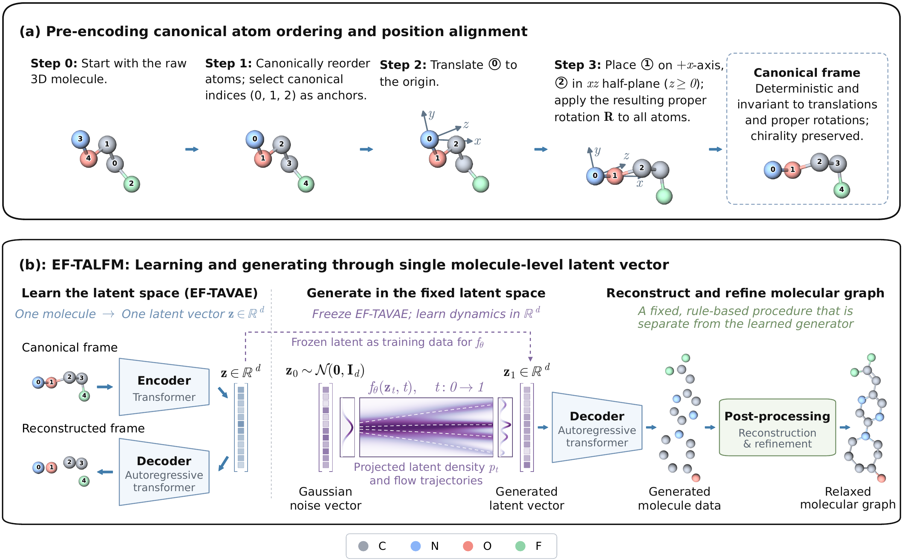

# EF-TALFM: Fixed-Dimensional Latent Flow for Generating Variable-Size 3D Molecules

**Paper:** [Fixed-Dimensional Latent Flow for Generating Variable-Size 3D Molecules](https://arxiv.org/abs/2609.08333)

**Authors:** Weichi Yao, Cameron Gruich, Bryan R. Goldsmith, and Yixin Wang

[](figures/paper/preencoding_extended_ef_talfm_pipeline.pdf)

## Overview

Molecular size, composition, and geometry are interdependent and jointly shape molecular properties. Many 3D molecular generators nevertheless require the atom count to be chosen before generation.

**EF-TALFM (Equivariant-Free Transformer-Autoencoded Latent Flow Matching)** generates variable-size 3D molecules from a single fixed-dimensional molecule-level latent vector. An autoregressive decoder determines molecular size as it generates each molecule.

The framework has two training stages:

1. **Molecular autoencoding (EF-TAVAE).** A bidirectional Transformer encodes each canonically ordered and aligned molecule into a latent vector. An autoregressive Transformer predicts molecule-level chemical attributes and generates atom types, coordinates, and atom-level attributes until it emits an end-of-molecule token.
2. **Latent flow matching.** With the autoencoder frozen, a flow model learns to transport Gaussian noise to the molecular latent distribution, optionally conditioned on a target property.

Efficient training and sampling motivate two complementary representation choices. 

- **Bond-free decoding with additional atom- and molecule-level chemical attributes.** We adopt bond-free design but augments atom types and coordinates with other atom- and molecule-level attributes that guide deterministic bond reconstruction, avoiding a learned dense bond-prediction head. 
- **Canonical atom ordering and rigid-pose alignment.** A lightweight reprocessing step standardizes molecular sequences and coordinates, which resolves sequence and coordinate ambiguities. It enables standard Transformer autoencoding and residual networks for latent flow matching without computationally expensive equivariant layers or data augmentation that requires substantially more training iterations, providing a basis for scalable training and sampling.

For property-conditioned generation, 
- **Internal property readout selection.**  A property readout learned during autoencoder training ranks and selects generated candidates by agreement with the target property, designed to help focus costly downstream evaluation on promising candidates.

On PCQM4Mv2, EF-TALFM achieves a higher yield of unique, novel molecules passing chemical and geometric checks than the evaluated baselines, with lower end-to-end training and sampling times under the reported budgets. For HOMO-LUMO gap targeting, internal-readout selection approximately doubles the density functional theory (DFT)-verified hit rate among retained candidates while largely preserving structural novelty and diversity.

## Citation
```bibtex
@article{yao2026fixed,
  title={Fixed-Dimensional Latent Flow for Generating Variable-Size 3D Molecules},
  author={Yao, Weichi and Gruich, Cameron and Goldsmith, Bryan R. and Wang, Yixin},
  journal={arXiv preprint arXiv:2609.08333},
  year={2026},
  doi={10.48550/arXiv.2609.08333},
  url={https://arxiv.org/abs/2609.08333}
}
```
